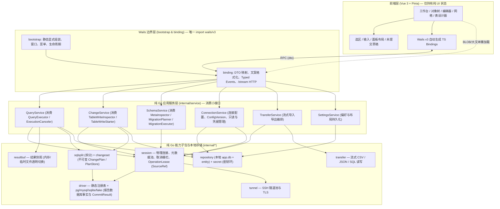

# 01. 系统总体架构与模块边界

本文档定义 `Hesper` (`hesper`) 的**技术栈清单、依赖方向、消费侧接口归属、状态所有权、通信通道与本地持久化安全**。关于取消、翻页、并发写入与跨库改表的行为语义，权威定义见 [02-database-engine-design.md](./02-database-engine-design.md)。

---

## 1. 架构核心原则：同一件事由一处负责

### 1.1 优先保护两条清晰主干路径
1. **普通查询主路径**：编辑器发起执行 → `QueryService` 找到该 Tab 的独占会话 → `driver` 执行 → 返回结果 (或快照切片)。
2. **元数据浏览路径**：对象树展开 / 补全刷新 → `SchemaService` 从独立元数据连接池取连接 → `driver` 探测元数据 → 返回结果。
3. **安全网格写入路径**：预览与提交均经 `session.Manager.AcquireOperation` 借用独立短连接 (纳入连接生命周期与配置版本校验)，避免污染或复用标签页长会话。

三条路径物理隔离，确保标签 A 的事务与临时表不会落到标签 B，慢查询不会卡死左侧对象树与取消通道，网格写入短事务与编辑器手动事务互不干扰。

### 1.2 四条模块边界规则

| 边界 | 职责划分 | 直接收益 |
| :--- | :--- | :--- |
| **桌面与存储** | Wails v3 仅留在 `bootstrap` 与 `binding`；`repository` 只管理本地配置库 `app.db`，`driver` 与 `session` 访问用户目标数据库。 | 改查询历史存储格式只动本地持久化；业务与驱动测试无需启动桌面壳。 |
| **查询、写入与改表** | 遵循**消费侧小接口**：`QueryService` 消费执行与取消接口；`ChangeService` 消费 `TableWriteInspector` / `TableWriteStarter` / `TableWriteTx`；迁移模块消费自己的规划/执行接口。同一个驱动对象可同时实现多个小接口；`session` 统一持有连接、调度执行、维护会话与短操作生命周期。 | 驱动方言锁、表结构读取与提交三态判定全部收口在驱动内部，上层服务不耦合方言细节。 |
| **引擎与界面** | `driver` 只报告数据库客观事实，`binding` 负责映射面向展示的 DTO 与用户提示文案 (稳定值类型可共享)。前端只展示后端确认的会话/事务状态，自己只管选区、输入、未提交草稿等纯 UI 状态。 | 改报错或报告文案不动驱动；前后端不会各自猜测事务是否已结束。 |
| **四库差异** | 四个内置驱动采用静态显式注册；MySQL 与 MariaDB 复用底层连接实现，差异留在方言与能力判断中。支持序列的驱动才提供序列浏览；某张表或列能否编辑，由后端结合连接设置、权限、键、类型、排序规则和存储引擎综合判定。 | 新增方言能力不动其他驱动；前端仅消费 `Insertable` / `Updatable` / `ReadOnlyReason`，不做方言推断。 |

### 1.3 反过度抽象准则
- **新增抽象的标准**：只有当能够明确指出“今天哪两个调用方需要独立变化”或“哪条关键规则因此只需维护一次”时，才引入接口或中间层。
- 普通包函数能完成的工作直接调用，不套无意义包装器。
- 四款内置驱动在 `bootstrap` 静态显式注册即可，不做动态插件加载机制。
- 查询结果缓存由独立的 `ResultBuffer` 模块负责，内存驻留与本地临时文件溢写之间的切换对前端完全透明。

---

## 2. 完整技术栈与依赖清单

### 2.1 后端与桌面运行时 (Go + Wails v3)

| 类别 | 选型 | 协议 | 说明 |
| :--- | :--- | :--- | :--- |
| **桌面框架** | `github.com/wailsapp/wails/v3` (v3.1+) | MIT | 原生多窗口、菜单、文件对话框、自动生成 TS Bindings、内置更新器 |
| **Go 工具链** | **Go 1.26+** | BSD-3 | Wails v3.0+ 最低构建基线 |
| **PostgreSQL 驱动** | `github.com/jackc/pgx/v5` | MIT | 原生协议、OID 类型系统、`CancelRequest`、`CopyFrom`、`QueryExecModeExec` |
| **MySQL / MariaDB 驱动** | `github.com/go-sql-driver/mysql` | MPL-2.0 | 复用连接层，支持 `caching_sha2_password`、`clientFoundRows`、自定义 Dialer |
| **SQLite 驱动** | `modernc.org/sqlite` | BSD-3 | 纯 Go 免 CGO，降低 Win/Linux 交叉编译复杂度 |
| **SSH 隧道** | `golang.org/x/crypto/ssh` | BSD-3 | 密码/私钥/Passphrase/Agent 与零本地端口 `DialContext` 复用 |
| **密钥环与加密** | `github.com/zalando/go-keyring` + `argon2` + `crypto/aes` | MIT/BSD-3 | 系统密钥环优先，无密钥环桌面自动降级为主密码 AES-256-GCM |
| **日志系统** | 标准库 `log/slog` | BSD-3 | 结构化日志与本地滚动日志输出 |

### 2.2 前端 UI 技术栈 (Vue 3 + TypeScript)

| 类别 | 选型 | 协议 | 说明 |
| :--- | :--- | :--- | :--- |
| **框架与构建** | **Vue 3.5+ / TypeScript 5.x / Vite 6+** | MIT | `<script setup>` + Pinia，复杂表单与桌面工作台开发高效 |
| **状态管理** | **Pinia** | MIT | 仅管理客户端 UI 状态、弹窗/通知、元数据缓存与后端确认状态的镜像 |
| **样式与基础组件** | **Tailwind CSS 4 (`@theme` 语义 Token)** + 自建轻量基础组件 | MIT | `BaseModal` / `ConfirmDialog` / `PaginationBar` / `CellText` / `ToastHost`，紧凑高密度桌面风且零冗余依赖 |
| **图标与工作台布局** | `lucide-vue-next` + 自建轻量标签栏与分屏 | ISC / MIT | 多 Tab 切页保留编辑器与网格状态 (`v-show`)，配合 `useDragResize` 调节侧栏与上下分屏 |
| **SQL 编辑器** | **CodeMirror 6** (`@codemirror/lang-sql`) | MIT | 轻量、多 Tab 内存低、原生四库方言与中文 IME 友好 |
| **数据网格与虚拟树** | `@tanstack/vue-virtual` (行/列双虚拟化网格 + 展平虚拟对象树) | MIT | 手写轻量网格与展平对象树，大宽表与数千张表均按视口渲染 |
| **ER 图 (后期)** | `@vue-flow/core` | MIT | 原生 Vue 3 关系图画布 |

---

## 3. 依赖方向、接口消费与状态所有权

依赖方向严格单向无环：**`main.go` → `bootstrap` → `binding` → `service` → 能力子包 & `repository`**。



### 状态所有权总表 (杜绝多处各自推断)

| 状态类别 | 唯一持有者 | 其他层允许的操作 |
| :--- | :--- | :--- |
| 连接配置、分组、查询历史、偏好设置 | `internal/repository` (本地 `app.db`) | `service` 读写，`binding` 映射为不含凭据的 `dto` |
| 密码与 SSH 私钥口令 | `internal/secret` (系统密钥环 / 加密存储) | 仅 `ConnectionService` / `session` 内部解析，永不回传前端 |
| 连接配置版本 (`ConfigVersion`) | `ConnectionService` (`cfgMu` 保护) | `SaveConnection`/`DeleteConnection` 递增；`PrepareRuntimeSSHCredential` 保存凭据不递增 |
| 物理连接、Tab 会话态、事务态、取消栅栏、`LifecycleEpoch` 与 `OperationLease` | `internal/session` | `driver` 上报底层事实，`session` 权威维护；`CloseConnection`/`CloseAll` 递增 `LifecycleEpoch` 并取消在途短操作 |
| 网格变更计划执行状态机 (`Ready → Preparing → Executing → Finished`) | `internal/changeset.PlanStore` | 唯一状态持有者；进入 `Finished` 立即释放 `Steps` 内存负载，不因断连而删除执行中或终态记录 |
| 编辑器一次性查询的结果快照 (内存/临时文件) | `internal/resultbuf` | `QueryService` 创建/切片/释放，界面无感知底层存储介质 |
| 表与列可编辑性 (`TableEditability` + `WriteSchema`) | 后端 `driver` 综合计算 | 前端仅消费 `Insertable` / `Updatable` / `ReadOnlyReason` 与 `TableEditability` |
| 网格选区、编辑器输入、未提交的脏数据草稿、Tab 布局 | 前端 Pinia Stores | 提交前由前端暂存，提交时发往后端生成同源 `ChangePlan` |

---

## 4. 工程目录结构

```text
hesper/
├── main.go                       # 极简入口 (<40行)：Linux 图形自检 + bootstrap.Run()
├── Taskfile.yml                  # Wails v3 构建与打包任务
├── sql/                          # 本地 SQLite app.db 迁移脚本 (go:embed)
│   └── 001_init.sql
├── build/                        # Windows / Linux (deb, PKGBUILD, AppImage) / Darwin 打包资源
├── docs/                         # 设计文档目录
├── internal/
│   ├── bootstrap/                # 静态显式依赖组装 (无黑盒 DI)、驱动注册、窗口与菜单初始化
│   ├── config/                   # 运行时配置与跨平台路径解析 (XDG / AppData / Portable)
│   ├── platform/                 # OS 条件编译 (graphics_linux.go / graphics_other.go 等)
│   ├── binding/                  # 【唯一引入 wails/v3 的业务适配层】DTO 映射、展示文案、事件、/stream HTTP
│   ├── dto/                      # 前后端稳定契约与展示 DTO (不含明文密码/内部句柄)
│   ├── service/                  # 纯 Go 业务编排层 (Connection / Schema / Query / Change)
│   ├── entity/                   # 本地 app.db 存储实体 (与 dto 物理隔离)
│   ├── repository/               # 本地 app.db 访问层 (连接、历史、收藏、kv)
│   ├── secret/                   # 系统密钥环 + Argon2id/AES-GCM 主密码兜底
│   ├── session/                  # 双轨连接持有、取消栅栏、权威会话状态机与受管短操作租约 (OperationLease)
│   ├── resultbuf/                # 编辑器 Execute-Once 结果快照缓冲 (内存/临时文件透明溢写与释放)
│   ├── driver/                   # 驱动基础值类型、静态注册表 + 各数据库实现 (含 TableWriteStarter / TableWriteTx)
│   │   ├── driver.go
│   │   ├── fake/                 # 内存模拟与故障注入驱动 (仅用于纯单测，不替代真库验收)
│   │   ├── postgres/             # PostgreSQL 实现 (pgx/v5)
│   │   ├── mysql/                # MySQL & MariaDB 共享连接实现 + 分支方言/能力适配
│   │   └── sqlite/               # SQLite 实现 (modernc + 严格主键与 table_xinfo 识别)
│   ├── tunnel/                   # 零本地端口 SSH 跳板机隧道池与 5 模式 TLS Config 构建
│   ├── sqlsplit/                 # 多方言状态机 SQL 拆分与语句粗分类
│   ├── changeset/                # 不可变 ChangePlan、SchemaFingerprint、分离新/原值绑定与单持有者 PlanStore
│   └── transfer/                 # 流式 CSV / JSON / SQL 读写器
└── frontend/                     # Vue 3 + TypeScript + Vite
    ├── bindings/                 # `wails3 generate bindings -ts -i` 自动生成 (禁止手改)
    └── src/                      # api / stores / components / composables / styles
```

---

## 5. 通信通道与数据保真契约

### 5.1 三级通信通道

| 通道 | Wails v3 机制 | 适用场景 | 边界约束 |
| :--- | :--- | :--- | :--- |
| **结构化 RPC** | `internal/binding` + 生成的 TS Bindings | 连接测试、对象浏览、单页结果读取、变更计划与改表计划 | 单次返回为受控单页数据，统一经 `dto` 传输 |
| **异步事件** | Wails Typed Events | 导入导出进度（100ms 节流）、长查询耗时、会话丢失通知 | 仅传轻量状态消息，不传结果行 |
| **本地二进制流** | `binding/stream_http.go`（`http.Handler`，挂载 `/stream/*`） | 大 `BLOB`/`BYTEA` 预览下载、超长文本（> 64KB）按需加载 | 绕开 JSON 编解码，前端直接拉取原始字节 |

### 5.2 单元格值保真结构（共享稳定值类型）
JavaScript `Number` 最大安全整数为 $2^{53}-1$。为避免 `BIGINT`、`UNSIGNED BIGINT`、`DECIMAL` 静默丢精度以及大对象撑爆渲染进程，结果单元格统一使用共享值类型 `CellValue`（列元信息 + 紧凑二维数组传输，减少 JSON 冗余）：

```go
type ValueKind string

const (
    KindNull     ValueKind = "null"
    KindBool     ValueKind = "bool"
    KindInt      ValueKind = "int"
    KindBigInt   ValueKind = "bigint"   // 强制精确字符串传输
    KindDecimal  ValueKind = "decimal"  // 强制精确字符串传输，保留小数位
    KindFloat    ValueKind = "float"
    KindString   ValueKind = "string"
    KindDateTime ValueKind = "datetime" // 保留数据库原始时间文本，避免隐式时区篡改
    KindJSON     ValueKind = "json"
    KindBinary   ValueKind = "binary"   // 仅传摘要 + 字节数 + StreamRef
    KindArray    ValueKind = "array"
    KindEnum     ValueKind = "enum"
)

type CellValue struct {
    Kind         ValueKind `json:"kind"`
    Text         string    `json:"text,omitempty"`
    Truncated    bool      `json:"truncated,omitempty"`
    ByteLength   int64     `json:"byteLength,omitempty"`
    StreamRef    string    `json:"streamRef,omitempty"`
    StorageClass string    `json:"storageClass,omitempty"` // SQLite typeof: null|integer|real|text|blob
}
```

### 5.3 错误码索引
`driver` / `session` / `service` 上报结构化领域错误，`binding` 统一映射为 `dto.AppError` (错误码 + 面向界面的可读文案)。具体触发条件与语义以 [02-database-engine-design.md](./02-database-engine-design.md) 为准：
- 连接与认证：`ERR_AUTH_FAILED` (含 `SSHAuthPrompt`)、`ERR_TUNNEL_FAILED` (含 `HostKeyChallenge`)、`ERR_CONNECTION_FAILED`
- 执行与会话：`ERR_SQL_SYNTAX`、`ERR_STATEMENT_CANCELED`、`ERR_SESSION_LOST`、`ERR_COMMIT_OUTCOME_UNKNOWN`、`ERR_TX_ABORTED`
- 只读与快照：`ERR_READ_ONLY_DENIED`、`ERR_RESULT_EXPIRED`
- 写入与改表：`ERR_CONCURRENCY_CONFLICT` (含 `ConflictRowKey`)、`ERR_ROW_NOT_IDENTIFIABLE`、`ERR_BATCH_NON_TRANSACTIONAL`、`ERR_SCHEMA_CHANGED`、`ERR_PLAN_INVALIDATED`、`ERR_PRECISION_UNSUPPORTED`、`ERR_DDL_EXECUTION_INCOMPLETE`

---

## 6. 本地存储与凭据安全

### 6.1 数据目录规范
- **Linux**：遵循 XDG Base Directory (配置/数据库 `$XDG_CONFIG_HOME/hesper/app.db`、结果快照临时目录 `$XDG_CACHE_HOME/hesper/results/`、日志 `$XDG_STATE_HOME/hesper/logs/`)。
- **Windows**：安装版写入 `%APPDATA%\hesper\` 与 `%LOCALAPPDATA%\hesper\`；绿色便携版检测到同级 `portable.flag` 时全部写入 `./data/`。

### 6.2 本地配置库核心表（`sql/001_init.sql`）

```sql
CREATE TABLE connection_groups (
    id          TEXT PRIMARY KEY,
    parent_id   TEXT REFERENCES connection_groups(id) ON DELETE CASCADE,
    name        TEXT NOT NULL,
    sort_order  INTEGER NOT NULL DEFAULT 0,
    created_at  INTEGER NOT NULL
);

CREATE TABLE connections (
    id             TEXT PRIMARY KEY,
    group_id       TEXT REFERENCES connection_groups(id) ON DELETE SET NULL,
    name           TEXT NOT NULL,
    driver         TEXT NOT NULL, -- 'postgres' | 'mysql' | 'mariadb' | 'sqlite'
    env_color      TEXT NOT NULL DEFAULT 'default', -- 'red' | 'amber' | 'green' | 'default'
    read_only      INTEGER NOT NULL DEFAULT 0,
    config_json    TEXT NOT NULL, -- Host, Port, User, DefaultDB, FilePath, TLSConfig, SSHConfig, Options
    secret_ref     TEXT,          -- 系统密钥环键名或加密密文引用（严禁存明文密码）
    sort_order     INTEGER NOT NULL DEFAULT 0,
    created_at     INTEGER NOT NULL,
    updated_at     INTEGER NOT NULL
);

CREATE TABLE query_history (
    id             TEXT PRIMARY KEY,
    connection_id  TEXT NOT NULL,
    database_name  TEXT,
    sql_text       TEXT NOT NULL,
    status         TEXT NOT NULL, -- 'ok' | 'error' | 'canceled' | 'unknown'
    duration_ms    INTEGER NOT NULL,
    affected_rows  INTEGER,
    error_code     TEXT,
    executed_at    INTEGER NOT NULL
);

CREATE TABLE saved_queries (
    id             TEXT PRIMARY KEY,
    connection_id  TEXT,
    title          TEXT NOT NULL,
    folder         TEXT NOT NULL DEFAULT '',
    sql_text       TEXT NOT NULL,
    updated_at     INTEGER NOT NULL
);

CREATE TABLE app_kv (
    key            TEXT PRIMARY KEY,
    value_json     TEXT NOT NULL,
    updated_at     INTEGER NOT NULL
);
```

### 6.3 凭据保护策略
1. **系统密钥环优先**：通过 `zalando/go-keyring` 将数据库密码与 SSH 私钥口令存入 Windows Credential Manager / Linux Secret Service。
2. **无密钥环兜底**：在未运行 Secret Service 的最小化 Linux 桌面环境中，提示用户设置主密码，以 `Argon2id` + `AES-256-GCM` 加密保存，启动解锁后密钥仅驻留 Go 内存。
3. **单向隔离**：`binding` 永不将明文密码序列化回前端；编辑连接时仅返回 `hasPassword: true`，仅在用户输入新值时单向覆写。
