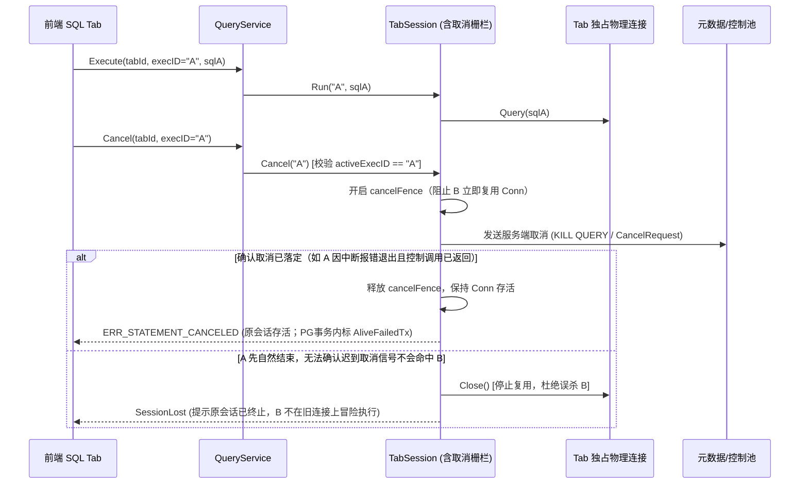

# 02. 数据库引擎与核心行为契约

本文档是 `Hesper` 中**驱动小接口拆分、取消与断线语义、只读与翻页契约、网格并发写入规则、以及跨库改表迁移结果**的**唯一权威定义**。前端交互与测试验收均以此处规则为准。

---

## 1. 消费侧小接口与驱动注册模型

### 1.1 按消费方拆接口，不造胖接口
各数据库驱动实现体（`postgres`、`mysql`、`sqlite`、`fake`）是一个内聚的连接/引擎对象，但上层模块只依赖自己真正需要的小接口；**不需要为此新建额外连接、进程或中间转发服务**。

```go
package driver

import "context"

type EngineType string

const (
    EnginePostgres EngineType = "postgres"
    EngineMySQL    EngineType = "mysql"
    EngineMariaDB  EngineType = "mariadb"
    EngineSQLite   EngineType = "sqlite"
    EngineFake     EngineType = "fake"
)

// BoundStatement 显式绑定参数的 SQL 语句，供执行与预览严格共用
type BoundStatement struct {
    SQL  string
    Args []any
}

// 1. 供 session / bootstrap 使用的工厂入口（静态显式注册）
type Opener interface {
    Type() EngineType
    Open(ctx context.Context, cfg ResolvedConfig) (Conn, error)
}

// 2. 供 QueryService 消费的查询与取消接口
type QueryExecutor interface {
    Query(ctx context.Context, stmt BoundStatement) (RowStream, error)
    Exec(ctx context.Context, stmt BoundStatement) (ExecFact, error)
    BeginTx(ctx context.Context) (Tx, error)
}

type ExecutionCanceler interface {
    // 返回服务端取消信号是否已确认完成（false 表示信号可能仍在途，调用方须停止复用连接）
    CancelInFlight(ctx context.Context, controlConn Conn) (confirmed bool, err error)
}

// 3. 供 SchemaService 消费的基础元数据与表可编辑性判定接口
type MetaInspector interface {
    ServerFact(ctx context.Context) (ServerFact, error)
    Capabilities(serverVersion string) Capabilities
    ListDatabases(ctx context.Context) ([]DatabaseFact, error)
    ListSchemas(ctx context.Context, db string) ([]string, error)
    ListTables(ctx context.Context, db, schema string) ([]TableSummaryFact, error)
    GetTableDetail(ctx context.Context, db, schema, table string) (*TableDetailFact, error)
    GetTableDDL(ctx context.Context, db, schema, table string) (string, error)
    // 结合权限、显式键和存储引擎，由后端权威计算单表可编辑性
    InspectTableEditability(ctx context.Context, db, schema, table string, clientReadOnly bool) (TableEditability, error)
    ListViews(ctx context.Context, db, schema string) ([]ObjectFact, error)
    ListTriggers(ctx context.Context, db, schema, table string) ([]TriggerFact, error)
    FetchCompletionCatalog(ctx context.Context, db, schema string) (*CompletionCatalog, error)
}

// 可选能力接口：仅支持相应能力的驱动实现，不污染其他驱动
type SequenceInspector interface {
    ListSequences(ctx context.Context, db, schema string) ([]ObjectFact, error)
}

type RoutineInspector interface {
    ListRoutines(ctx context.Context, db, schema string) ([]ObjectFact, error)
}

// 仅支持会话内原地切库的驱动（MySQL/MariaDB 的 USE）实现；PostgreSQL 不实现此接口而采用重建连接切库
type DatabaseSwitcher interface {
    SwitchDatabase(ctx context.Context, db string) error
}

// PostgreSQL 第二驱动验证暴露的最小增量接口：仅具备 Database -> Schema -> Table 层级的驱动实现（如 SET search_path）
type SchemaSwitcher interface {
    SwitchSchema(ctx context.Context, schema string) error
}

// 4. 供改表迁移模块消费的独立接口（测试查询/取消时完全无需实现它）
type MigrationPlanner interface {
    BuildMigrationPlan(ctx context.Context, inspector MetaInspector, diff TableDiff) (*MigrationPlan, error)
}

type MigrationExecutor interface {
    ExecuteMigrationPlan(ctx context.Context, plan *MigrationPlan) (*MigrationReport, error)
}

// 5. 供预览格式化器消费的无状态方言工具
type DialectFormatter interface {
    QuoteIdent(ident string) string
    FormatPreviewSQL(stmt BoundStatement) string
}
```

> **事实与展示分离**：驱动只返回客观数据库事实（`*Fact`、能力标志、步骤执行事实），不拼装界面提示文案；面向前端的 `dto` 与本地化提示由 `internal/binding` 映射。

### 1.2 静态显式注册与四库分工
- `internal/driver/registry.go` 提供极简静态注册表，由 `internal/bootstrap` 显式注册 `postgres`、`mysql`（含 MariaDB 分支探测）、`sqlite` 及测试环境的 `fake`。
- **MySQL 与 MariaDB**：共享 `go-sql-driver/mysql` 底层连接与协议封装，建连后通过 `SELECT VERSION(), @@version_comment` 识别 `EngineMySQL` vs `EngineMariaDB` 与精确版本号，并将差异隔离在方言、能力判断与可选接口（如 MariaDB 实现 `SequenceInspector`）内。

---

## 2. 权威规则一：取消执行、断线与重连（`internal/session`）

`internal/session` 是所有外部数据库物理连接、执行调度与会话状态的唯一权威持有者。

### 2.1 双轨连接与状态定义
- **元数据池（Metadata Pool）**：按 `(connectionID, database)` 维护小型连接池（最大 2–3 条），专供对象树浏览、补全元数据刷新与 MySQL `KILL QUERY` 旁路控制，永不执行用户事务。
- **查询标签独占连接（Tab Session）**：每个查询 Tab 持有独立物理连接，维护权威会话状态：
  - `AliveIdle`：连接健康，不在事务中；
  - `AliveInTx`：连接健康，处于活跃事务中；
  - `AliveFailedTx`：连接健康，但处于事务报错中止态（如 PostgreSQL `25P02`），须 `ROLLBACK` 才能继续；
  - `SessionLost`：原物理连接已断开或因安全边界停止复用（原临时表、会话变量、锁与未提交事务均已失效）；
  - `CommitOutcomeUnknown`：`COMMIT` 已发出但在收到确认前断线或超时，**无法确认服务端是否提交**。

### 2.2 取消与连接复用栅栏（防迟到取消误杀下一条查询）
**核心规则：`execID` 只用于标识前端发起的某次执行请求，不能单独保证异步取消信号不命中下一条查询。**

考虑如下竞态场景：
> 取消请求 A 已通过 `activeExecID == A` 校验 → A 恰好在服务端收到取消信号前自然结束 → 同一 Tab 的查询 B 已排队准备复用该连接 → 迟到的 `KILL QUERY` / `CancelRequest` 到达服务端，把正在跑的 B 停掉了。

为此 `TabSession` 强制执行 **取消栅栏（Cancel Fence）** 与连接复用规则：
1. **登记在途取消**：一旦针对执行 `A` 的取消校验通过，在发送服务端取消指令前，`TabSession` 立即登记一个在途取消计数（`cancelFence`）并阻塞后续查询 `B` 进入该物理连接。
2. **安全复用前提**：**只有同时满足以下两个条件，才允许在同一物理连接上继续执行下一条查询 `B`**：
   - 上次执行 `A` 的驱动调用已经完全返回；
   - 发往服务端的取消信号已被明确确认落定，不会再迟到影响后续语句（例如：MySQL 旁路 `KILL QUERY` 已收到服务端响应，且 `A` 是在该响应返回之后退出，或 `KILL QUERY` 返回前 `A` 已受中断错误退出）。
3. **无法确认则停止复用（宁断勿误杀）**：
   - 对于无法确认取消信号何时到达/已被消费的场景（例如：PostgreSQL 的协议 `CancelRequest` 无服务端回包确认且 `A` 已自然完成导致信号可能仍在途；或旁路 `KILL QUERY` 超时未回包），`TabSession` **必须停止复用该物理连接**，主动关闭旧连接、将旧会话标记为 `SessionLost` 并明确告知界面，随后在用户确认或新会话中执行 `B`。
4. **MySQL / MariaDB 取消专项约束**：
   - 严禁通过直接 cancel 绑定在物理连接上的 `QueryContext` 来执行常规取消（`go-sql-driver/mysql` 会因此直接关闭底层 TCP 连接，销毁未提交事务与临时表）。
   - 常规取消必须先经由元数据连接池发送 `KILL QUERY <conn_id>` 等待服务端返回 `Error 1317`；仅当用户显式点击“强制断开”或服务端无响应超时后，才关闭连接并转入 `SessionLost`。

### 2.3 断线重连与 `COMMIT` 未知结果保护
- **禁止伪装无感重连**：物理连接中断后，即使新连接恢复了当前库或 `search_path`，**原临时表、会话变量、预编译语句与未提交事务均已丢失**。后端必须先进入 `SessionLost` 状态并通知前端，严禁静默重连后对外隐瞒会话已更换的事实。
- **`COMMIT` 与自动提交写入断线保护**：无论是自动提交模式下的写入/DDL 语句，还是显式 `COMMIT`（编辑器手写或 `Tx.Commit()`），只要请求字节已发往网络但在读取服务端确认前遭遇 EOF / 网络超时，后端**严禁断言“已回滚”或“已提交”且绝不自动重试**，必须切入 `CommitOutcomeUnknown` 并返回 `ERR_COMMIT_OUTCOME_UNKNOWN`。



---

## 3. 权威规则二：只读语义与结果翻页

### 3.1 只读模式：区分客户端防误写与数据库真实权限
系统明确区分两层保护，文档与界面均不做混淆承诺：

| 层级 | 作用机制 | 真实边界 |
| :--- | :--- | :--- |
| **数据库真实权限（强只读权威）** | 数据库账号本身的 `GRANT` / 角色权限；以及 SQLite 的本地只读打开（`file:<path>?mode=ro` + `PRAGMA query_only = ON`） | **生产环境强只读必须以实际数据库账号权限为准**（SQLite 除外，其文件与引擎级只读在本地可靠生效）。 |
| **客户端防误写护栏（`read_only=true` 连接选项）** | ① 前端锁定写入入口；② 会话初始化下发只读参数（PG `default_transaction_read_only=on`、MySQL/MariaDB `SET SESSION transaction_read_only=1`）；③ 后端对显式写语句、DDL 与切回读写模式（如 `SET ... READ WRITE`）做拦截返回 `ERR_READ_ONLY_DENIED`。 | 用于防止人手误操作；但 MySQL 某些隐式提交 DDL 或存储过程内部写操作仍受数据库账号权限制约，客户端不会将其伪装成数据库权限隔离。 |

### 3.2 双路径翻页语义（表浏览 vs 编辑器任意 SQL）

| 路径 | 数据来源 | 翻页语义与诚实边界 |
| :--- | :--- | :--- |
| **表数据浏览（`BrowseTable`）** | 实时查库 | 按稳定排序键（优先显式主键 / 非空唯一键，用户指定排序列后追加稳定键作 tie-breaker）实时查询当前页。**明确声明**：实时表浏览在静态数据下顺序稳定，但**不保证并发修改（尤其是修改了排序列的值、或插入/删除前页记录）时跨页不重不漏**。 |
| **SQL 编辑器执行（`ExecuteQuery`）** | **Execute-Once（只执行一次）** + `internal/resultbuf` 快照 | 编辑器中的 SQL **只向数据库执行一次**，后续翻页全部从该次执行产出的 `ResultBuffer` 快照切片读取，确保带 `RETURNING` 或副作用函数的语句绝不被二次执行。 |

**`ResultBuffer` 容量上限与释放契约**（内存与临时文件切换对界面透明）：
- **分级缓冲与上限**：小结果集（默认 ≤ 5,000 行且 ≤ 8 MiB）驻留内存；超过阈值自动溢写至本地缓存目录临时文件；单次执行设置可配置容量上限（默认 **50,000 行** 或 **64 MiB**），达上限时停止继续拉取并关闭数据库游标，返回 `truncatedByLimit: true`（提示用户缩小条件或使用流式导出）。
- **释放时机与过期规则**：同 Tab 下一次执行、Tab 关闭、连接关闭、应用退出时立即释放；非活跃 Tab 空闲超过 30 分钟或超出全局配额（默认 512 MiB）时按 LRU 回收。**快照过期后前端翻页返回 `ERR_RESULT_EXPIRED`，绝不自动重跑原 SQL**，须由用户显式点击重新执行。

---

## 4. 权威规则三：网格写入与并发冲突检测 (`internal/changeset` + `driver.TableWriteStarter`)

### 4.1 三维度独立判定 (`TableEditability`) 与列级能力
某张表在网格中允许哪些写入操作，由后端在 `TableWriteInspector.InspectWriteSchema` 中 fail-closed 计算并返回给前端：

```go
type RowIdentityKind string

const (
    RowIdentityNone          RowIdentityKind = "none"            // 无稳定唯一键
    RowIdentityPrimaryKey    RowIdentityKind = "primary_key"     // 真正非空唯一的显式主键
    RowIdentityUniqueNotNull RowIdentityKind = "unique_not_null" // 覆盖全表的显式非空唯一键
)

type TableEditability struct {
    CanWrite           bool            `json:"canWrite"`           // 连接非只读且为可写基表
    RowIdentity        RowIdentityKind `json:"rowIdentity"`        // 行可唯一定位方式
    KeyColumns         []string        `json:"keyColumns"`         // 构成稳定键的列名
    BatchTransactional bool            `json:"batchTransactional"` // 存储引擎是否支持整批原子回滚
    StorageEngine      string          `json:"storageEngine"`      // 如 InnoDB / MyISAM / heap / SQLite
    Reasons            []string        `json:"reasons,omitempty"`  // 受限原因事实码
}
```

**四库稳定键与可写性硬性约束**：
1. **稳定键完备性**：仅当 `RowIdentity` 为 **`primary_key`** 或 **`unique_not_null`** 且每条 `UPDATE` / `DELETE` 提供全部稳定键列的非空、未截断、非二进制、可比较原值时才允许改删；稳定键列绝不可因截断或二进制而从 `WHERE` 中省略。无稳定键表 (`RowIdentityNone`) 拒绝改删 (`ERR_ROW_NOT_IDENTIFIABLE`)，但若 `CanWrite == true` 仍允许网格 `INSERT`。
   - **SQLite 严格主键规则**：普通非 `STRICT` rowid 表上的 `TEXT PRIMARY KEY`、`INT PRIMARY KEY`、`INTEGER PRIMARY KEY DESC` 或未显式声明 `NOT NULL` 的复合主键在 SQLite 中允许重复 `NULL`，一律拒绝作为主键 (降级检索全列 `NOT NULL` 的非部分非表达式 `UNIQUE` 索引，均不满足则返回 `RowIdentityNone`)。仅以下四类主键可判为 `RowIdentityPrimaryKey`：(a) `WITHOUT ROWID` 表；(b) `STRICT` 表；(c) 单列精确 `INTEGER PRIMARY KEY` (`rowid` 别名，无 `origin="pk"` 自动索引)；(d) 全部主键列显式 `notnull = 1`。严禁使用隐式 `rowid` 延迟定位 (`VACUUM` 会重排 `rowid`)。
   - **PostgreSQL 索引键裁剪**：`PRIMARY KEY` 与 `UNIQUE NOT NULL` 均须按 `k.ord <= i.indnkeyatts` 排除 `INCLUDE (...)` 非键列，且排除部分索引 (`indpred IS NOT NULL`) 与表达式索引 (`attnum <= 0`)。
   - **MySQL / MariaDB 表达式索引安全**：`information_schema.STATISTICS.COLUMN_NAME` 必须按 `sql.NullString` 扫描，遇到函数/表达式索引立即排除，绝不阻断表结构探测；列可空映射采用 fail-closed `notNullMap`。
2. **列写入能力 (`Insertable` / `Updatable`)**：使用 PostgreSQL `attgenerated`/`attidentity`、MySQL `EXTRA` (`VIRTUAL GENERATED`/`STORED GENERATED`) 与 SQLite `PRAGMA table_xinfo` (`hidden=2/3`) 识别生成列与 `GENERATED ALWAYS AS IDENTITY` 列并标记只读；不可可靠比较类型 (`float`/`double`/`bytea`/`blob`/数组/复合/几何) 首版限制行内修改。前端仅消费后端下发的 `Insertable` / `Updatable` / `ReadOnlyReason`，不做方言判断。
3. **非事务表禁止整批提交**：MySQL / MariaDB 非 InnoDB (如 `MyISAM`) 标记 `BatchTransactional == false`，直接返回 `ERR_BATCH_NON_TRANSACTIONAL`。

### 4.2 六条核心执行边界与 `PlanStore` 单持有者状态机
1. **不可变 `ChangePlan` + `PlanStore` 状态机**：
   - `ChangePlan` 仅保存预览时锁定的不可变数据 (`SourceRef`、`SchemaFingerprint`、按固定顺序 **`Deletes → Updates → Inserts`** 排列的 `Steps`)。
   - `PlanStore` 唯一持有执行状态：`Ready → Preparing → Executing → Finished(Committed | NotCommitted | Unknown)`。仅建连前白名单可恢复错误 (SSH 主机指纹确认 `ERR_TUNNEL_FAILED + HostKeyChallenge`、SSH 凭据质询 `ERR_AUTH_FAILED + SSHAuthPrompt`、以及可明确识别的建连超时 `context.DeadlineExceeded` / `net.Error.Timeout()`) 释放回 `Ready` 并通过错误通道返回供前端 `runWithSSHChallenges` 复用同一 `planID`；其余所有失败 (含非超时连接错误如 SQLite 文件不存在、`BeginTableWrite` 锁超时/权限/SQLite busy、结构漂移、非事务引擎、上下文取消) 一律收口为 `Finished(NotCommitted)`。进入 `Executing` 后同一 `planID` 永久不可再执行；进入 `Finished` 立即释放 `Steps` 大负载，且 `defer` 清理严禁覆盖已写入的 `Finished` 终态。
   - **Wails 终态返回契约**：对于已产生明确执行终态 (`committed` / `not_committed` / `unknown`，含保留期内的终态缓存命中)，`ApplyGridChanges` 统一返回 `(resp, nil)`，确保前端 Promise 稳定读取 `resp.outcome`、`resp.conflictRowKey` 与 `resp.error`；仅交互式 SSH 质询、可重试建连超时及非法/过期/并发重入请求返回 `(zeroResp, appErr)`。
2. **受管操作租约 (`session.Manager.AcquireOperation`)**：
   - `PreviewGridChanges` 通过 `AcquireOperation(ctx, connID, db, nil)` 从本次租约直接取得 `SourceRef{ConnectionID, ConfigVersion, LifecycleEpoch, Target}`；`ApplyGridChanges` 传入 `&plan.Source`，锁内预登记可取消操作、锁外核对 `ResolvedConfig.ConfigVersion` 与目标后建连、回锁复查 `LifecycleEpoch` 与 `TunnelGen`。断连仅递增 `LifecycleEpoch` 并取消在途操作，不删除 `PlanStore` 终态记录。
3. **驱动原子保护与事务内 `SchemaFingerprint` 复核 (`TableWriteStarter` / `TableWriteTx`)**：
   - `BeginTableWrite` 在独立短连接上开启事务、取得表级保护 (PG `ACCESS SHARE`、MySQL/MariaDB `SHARED_READ` MDL、SQLite `BEGIN IMMEDIATE`) 并在同一事务内读取 `WriteSchema`，失败由驱动自行回滚。
   - `SchemaFingerprint` (SHA-256) 完整覆盖表属性与每列写入语义，包括完整 `Detail.ColumnType` (如 `DECIMAL(38,10)` vs `DECIMAL(38,2)`、`VARCHAR` 长度、`UNSIGNED`)、`HasDefault`、`DefaultValue`、`AutoIncrement`、`GeneratedKind`、`IdentityKind`、`Collation`、`Deterministic`、`SQLiteAffinity`、`WithoutRowID`、`Strict` 与比较策略；不一致直接回滚并返回 `ERR_SCHEMA_CHANGED`。
4. **驱动权威三态提交结果 (`CommitResult`)**：
   - `TableWriteTx.Commit(ctx)` 直接返回 `Committed | NotCommitted | Unknown`：仅按错误码与协议事实白名单判定 `NotCommitted` (PG 含 `pgx.ErrTxCommitRollback`、明确拒绝提交的 SQLSTATE 如 `22*`/`23*`/`25*`/`40000`/`40001`/`40002`/`40P01`/`42*`/`44*`/`53*`/`55*`；MySQL/MariaDB 含 `1048`/`1062`/`1205`/`1213`/`1290`/`1792`/`3819`/`4025` 及对应白名单 SQLSTATE)，**`40003` (`statement_completion_unknown`)**、连接/关停/内部异常、以及写包后任意断连或部分回包一律保守判 `Unknown` (`ERR_COMMIT_OUTCOME_UNKNOWN`, `RetrySafe: false`)；SQLite 采用本地文件提交错误码独立分类，不套用网络 `WriteSent` 规则。

### 4.3 分离新/原值绑定、No-op 剔除与方言原值校验谓词
- **互斥新值 (`NewCellValue`) 与独立原值 (`OriginalCellValue`)**：新值采用 `literal` / `null` / `default` 互斥模式；原值携带 `BrowseTable` 读取到的真实事实 (`Kind`, `Text`, `Truncated`, SQLite `StorageClass`)。
  - **SQLite 亲和性边界**：`BrowseTable` 同时读取 `typeof(<col>)` 填充 `StorageClass` 并在 `typeof == 'text'` 时保真返回原始文本 (防止 `DATETIME` 字符串被改写)。新值写入时 `TEXT`、无类型及 **`STRICT` 表的 `ANY` 列**保持原始输入文本 (含 `"000123"` 前导零与任意精度字符串；普通非 `STRICT` 表的 `ANY` 维持 `NUMERIC` 亲和性)；`NUMERIC`/`INTEGER` 列允许非数字文本 (如 ISO 时间戳、JSON) 原样按 `TEXT` 写入，对触发数值强转的数字字面量施加精确 `int64` 或严格 `big.Rat.SetFloat64(f)` 无舍入校验 (拒绝 `1e23` 等一切会舍入的数字并返回 `ERR_PRECISION_UNSUPPORTED`)；原值绑定按 `StorageClass` 忠实还原既有值 (如已有 `REAL 0.1`)，不套用新值精度限制。
- **No-op 剔除与 `UPDATE` `WHERE` 契约**：
  - 逐列比对新旧值 (严格区分 `NULL` vs `""` 与 SQLite `StorageClass`)，未变化单元格直接剔除；整行恢复原值则不生成 `UPDATE` (发 0 条写语句，不触发 `AFTER UPDATE` 触发器)。
  - 修改列原值为 `NULL` 时必须生成 `<col> IS NULL` (严禁生成 `= NULL` 或 `= ?`)；修改主键列本身时 `WHERE` 仍严格使用主键原值且不重复追加同一键列谓词。
- **按方言与排序规则生成精确比较谓词**：
  - **MySQL / MariaDB** (保持 `clientFoundRows=true` 核对 matched rows)：全部可编辑字符列 (含 `latin1` 等非 `utf8mb4` 列及 `utf8mb4_bin` 等 `PAD SPACE` 排序规则) 统一先转同字符集再逐字节比较：`CAST(CONVERT(<col> USING utf8mb4) AS BINARY) = CAST(CONVERT(? USING utf8mb4) AS BINARY)` (字符键列附加 `<col> = ?` 走索引)；MySQL `json` 采用 `CAST(<col> AS JSON) = CAST(? AS JSON)`。
  - **PostgreSQL**：`json` 采用 `<col>::text = $n`，`jsonb` 采用 `<col> = $n::jsonb`，非确定性排序字符列 (`!collisdeterministic`) 及 `citext` 采用 `<col>::text COLLATE "C" = $n` (键列附加 `<col> = $n`)。
  - **SQLite**：采用 `<col> COLLATE BINARY = ? AND typeof(<col>) = ?`，兼顾 `COLLATE NOCASE` 大小写敏感与动态存储类型区分。
- **原子回滚与精确行数校验**：任一条 `UPDATE` / `DELETE` 命中 `AffectedRows == 0` 立即回滚并返回 `ERR_CONCURRENCY_CONFLICT` (附 `ConflictRowKey`)；`AffectedRows > 1` 立即回滚并返回 `ERR_ROW_NOT_IDENTIFIABLE`；单行 `INSERT` 同样强制校验 `AffectedRows == 1` (如 PG `BEFORE INSERT` 触发器 `RETURN NULL` 跳过导致影响 0 行，立即回滚整批并返回 `ERR_TX_ABORTED`)。

---

## 5. 权威规则四：跨库改表计划与五态迁移报告

### 5.1 原子性由“版本 + 存储引擎 + 具体 DDL”共同决定
引擎绝不按数据库大类一刀切声明原子性，而是由 `MigrationPlanner` 结合**目标版本号、表存储引擎、以及本次实际包含的 DDL 语句集合**精确判定：
- **PostgreSQL**：普通多步 `ALTER TABLE` 在事务内可整体回滚（`AtomicityTransactional`）；但若计划包含 `CREATE INDEX CONCURRENTLY`、`ALTER TYPE ... ADD VALUE` 等不可事务化语句，须明确标示非事务边界。
- **MySQL / MariaDB**：DDL 会触发隐式提交。同表列/索引改动在 **MySQL 8.0+ 且 InnoDB** 下合并为单条多子句 `ALTER TABLE` 时标为 `AtomicitySingleStmt`；而在 **MySQL 5.7**、**MyISAM**、或跨多条语句（如同时重建外键/触发器）时，必须标为 `AtomicityNonAtomic` 并在执行前明示风险。
- **SQLite**：在事务内执行表重建时标为 `AtomicityTransactional`，但须显式声明将受影响的依赖视图与视图触发器。

### 5.2 五态迁移报告（`MigrationReport`）

每一步 DDL 的执行结果必须诚实落入以下 **5 种状态之一**：

```go
type StepOutcome string

const (
    StepApplied        StepOutcome = "applied"         // 已收到数据库确认生效
    StepRolledBack     StepOutcome = "rolled_back"     // 已确认由数据库事务回滚
    StepFailed         StepOutcome = "failed"          // 已收到数据库报错，确认未生效
    StepNotRun         StepOutcome = "not_run"         // 因前序失败或中止而未发出
    StepOutcomeUnknown StepOutcome = "outcome_unknown" // SQL 已发出但收到确认前断线/超时，结果未知！
)

type MigrationStepResult struct {
    Index         int         `json:"index"`
    Title         string      `json:"title"`
    SQL           string      `json:"sql"`
    Outcome       StepOutcome `json:"outcome"`
    ErrorCode     string      `json:"errorCode,omitempty"`
    RawDBError    string      `json:"rawDbError,omitempty"`
    RecoveryFact  string      `json:"recoveryFact,omitempty"` // 供 binding 映射恢复指引
}

type MigrationReport struct {
    PlanAtomicity     DDLAtomicity          `json:"planAtomicity"`
    OverallStatus     string                `json:"overallStatus"` // 'succeeded' | 'rolled_back' | 'partial_applied' | 'outcome_unknown'
    StepResults       []MigrationStepResult `json:"stepResults"`
    RequireInspectDDL bool                  `json:"requireInspectDdl"` // 出现 StepOutcomeUnknown 时为 true，禁止提示直接重试
}
```

> **核心安全原则**：只要任意步骤出现 `StepOutcomeUnknown`（SQL 已发出但确认丢失，如 MySQL/MariaDB 改表确认前断线），`RequireInspectDDL` 必须为 `true`——**严禁在界面提示“直接重试”**，必须要求用户先刷新核对当前表结构！

### 5.3 SQLite 含视图与 `INSTEAD OF` 触发器的安全表重建流程
当 SQLite 需要重建表结构（修改列类型、约束、顺序等）时，仅保留底表触发器是不够的：经 SQLite 3.38.2 / 3.45.1 实测，`DROP VIEW` 会级联静默删除挂在该视图上的所有 `INSTEAD OF` 触发器，导致原可写视图失效。

完整事务重建步骤如下：
1. **收集依赖对象**：
   - 底表关联的 `index` 与底表 `trigger`；
   - 所有直接或间接引用底表的 `view` 定义（按依赖拓扑序）；
   - **所有挂在上述受影响视图上的 `INSTEAD OF` 触发器**（`SELECT name, sql FROM sqlite_master WHERE type='trigger' AND tbl_name IN (<affected_views>)`）。
2. 读取 `PRAGMA foreign_keys` 原值；若为开启态，在事务外执行 `PRAGMA foreign_keys = OFF;`（`defer` 保证无论成功或失败均恢复原值）。
3. `BEGIN IMMEDIATE;`
4. 按逆依赖序 `DROP VIEW` 暂删所有受影响视图（避免后续 `DROP TABLE` / `ALTER TABLE RENAME` 在 `legacy_alter_table=OFF` 下触发引用报错）。
5. 创建新结构临时表 `_tmp_rebuild_<table>_<ts>` 并按精确列映射迁移数据（`INSERT INTO _tmp (...) SELECT ... FROM <table>`）。
6. `DROP TABLE <table>;` → `ALTER TABLE _tmp RENAME TO <table>;`
7. 重建底表所有 `index` 与底表 `trigger`。
8. 按正依赖序重建所有暂删的 `view`，并对每个视图执行 `EXPLAIN SELECT * FROM <view> LIMIT 0` 校验列引用完整性（若用户删除了视图依赖列，此处立刻报错并整事务 `ROLLBACK`，返回冲突视图名）。
9. **按序恢复所有收集到的视图 `INSTEAD OF` 触发器**。
10. 执行 `PRAGMA foreign_key_check;`（外键违背则整事务 `ROLLBACK`）。
11. `COMMIT;`（若 `COMMIT` 阶段断线则汇报 `StepOutcomeUnknown`）。
12. 恢复原 `PRAGMA foreign_keys` 设置。

---

## 6. 配套基础能力（SSH / TLS、SQL 拆分、流式导入导出）

- **SSH 隧道池（`internal/tunnel`）**：支持密码、私钥（含 Passphrase）与系统 SSH Agent；通过 `sshClient.DialContext` 直接注入 `pgx` / `mysql` Dialer（不占本地监听端口）；每 30 秒心跳保活；Known Hosts 首次指纹确认持久化；隧道断线时同步将依赖它的活跃 `TabSession` 切入 `SessionLost`。
- **SSL/TLS**：统一 `disable` / `prefer` / `require` / `verify-ca` / `verify-full` 与自定义 CA/Client 证书。
- **多方言 SQL 拆分器（`internal/sqlsplit`）**：状态机跳过引号、注释、PG `` `$$tag$$` `` 美元引号与 MySQL `DELIMITER`；输出每条语句的起止偏移、行号及粗分类（识别 `COMMIT`、写语句、DDL 供会话保护与只读护栏使用）。
- **流式导入导出（`internal/transfer`）**：纯后端流式读写 CSV / JSON / 批量 SQL Insert，大 `.sql` 文件按 `sqlsplit` 流式执行（PG 导入优先走 `pgx.CopyFrom`），通过回调接口汇报节流进度，零 Wails 依赖。
